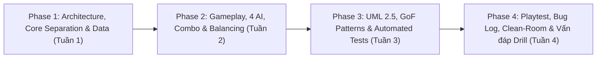

# LỘ TRÌNH TRIỂN KHAI & MILESTONES (UPGRADE ROADMAP)
## DỰ ÁN: SUPER MARIO 2D PLATFORMER (HỌC PHẦN MI4090 – K69)
**Tiêu chuẩn chất lượng:** Khung Kiểm định Hai chiều A ↔ B – TS. Trần Ngọc Thăng (HUST)  
**Mục tiêu điểm số:** Điểm A (Xuất sắc 9.5 – 10.0đ), 100% Cổng kiểm định PASS  

---

## 1. TỔNG QUAN LỘ TRÌNH 4 PHASES (SPRINTS)

Lộ trình được thiết kế theo mô hình xoắn ốc phụ thuộc kỹ thuật (Architecture First → Gameplay & Patterns → Test Automation → Clean-Room Delivery & Defense Drill):



---

## 2. CHI TIẾT TỪNG GIAI ĐOẠN TRIỂN KHAI

---

### PHASE 1: NỀN TẢNG KIẾN TRÚC, TÁCH LÕI CORE & DỮ LIỆU SAVE/LOAD
*Thời lượng dự kiến: Tuần 1 | Trọng tâm: Tách biệt hoàn toàn Core Logic khỏi Engine (Tiêu chí 1.2, 2.2, 4.3, 4.5)*

#### Mục tiêu:
Xây dựng giải pháp kiến trúc 3 tầng sạch (Clean Architecture). Bóc tách mã nguồn thành `SuperMario.Core` (.NET Standard/Core) thuần C# với **0% tham chiếu UnityEngine**. Xây dựng cơ chế nạp màn JSON và hệ thống Save/Load bền vững. Dọn dẹp toàn bộ dead code.

#### Danh sách đầu việc cụ thể (Task Checklist):
- [x] **1.1. Dọn dẹp mã nguồn rác:** Xóa bỏ thư mục `Assets/Scripts/NOT RELEVANT, DELETE/`, tệp rỗng `Assets/Scripts/PowerUps/.cs`, tệp `.DS_Store`, tệp crash `mono_crash.0.0.json`.
- [x] **1.2. Khởi tạo Cấu trúc Solution 3 tầng chuẩn:**
  - `src/SuperMario.Core/`: Class Library C# thuần (.NET 8/10), không tham chiếu Unity DLL.
  - `src/SuperMario.Data/`: Class Library xử lý I/O tệp JSON (Newtonsoft.Json / System.Text.Json).
  - `src/SuperMario.App/`: Project Unity 2D (Chỉ chứa View, Animation, Particle, New Input System).
  - `tests/SuperMario.Tests/`: Project xUnit kiểm thử tự động.
- [x] **1.3. Xây dựng các Value Object & Domain Foundation thuần C#:**
  - Tạo `Vector2D` (struct thuần C# với các toán tử `+`, `-`, `*`, `Magnitude`, `Normalized`).
  - Tạo `BoundingBox` (AABB thuần C# với hàm `Intersects()`).
  - Tạo cây CustomException: `MarioGameException`, `SaveCorruptedException`, `InvalidLevelDataException`, `EntityOutOfBoundsException`.
- [x] **1.4. Thiết kế Interfaces & Hợp đồng giao tiếp (DIP):**
  - Tạo `IInputProvider` (đọc phím trừu tượng: `IsJumpPressed`, `MoveAxisX`, `IsShootPressed`).
  - Tạo `ISaveStorage` (hợp đồng lưu/tải snapshot ván chơi).
  - Tạo `IHudObserver` (hợp đồng cập nhật điểm, máu, mạng ra giao diện).
- [x] **1.5. Xây dựng Trình nạp Màn & Quản lý Lưu trữ:**
  - Viết `JsonLevelLoader` nạp schema màn chơi từ tệp JSON.
  - Viết `JsonSaveStorage` lưu và khôi phục 100% snapshot ván chơi (`save_slot_1.json`).
  - Viết `HighScoreRepository` quản lý Top 10 kỷ lục (`highscores.json`).
- [x] **1.6. Cài đặt Generic Object Pool:**
  - Xây dựng `GenericPool<T>` tái sử dụng đạn và quái, loại bỏ cấp phát rác trong `Update()`.

#### Tiêu chí hoàn thành (Definition of Done - DoD):
- [x] Dự án biên dịch thành công; project `SuperMario.Core` không chứa bất kỳ từ khóa `using UnityEngine;` nào.
- [x] Có thể chạy một chương trình Console hoặc Test đơn giản đọc tệp `level_01.json` và in ra danh sách thực thể thành công.
- [x] Thực hiện Save dữ liệu ra JSON → Đóng ứng dụng → Mở lại Load thành công 100% dữ liệu.

#### Phân công gợi ý (Nhóm 2 người - Tỷ lệ 50/50):
- **Thành viên 1 (Core & Data Lead):** Thực hiện Task 1.2, 1.3, 1.4, 1.5 (Tách Core, Value Object, Cây Exception, `JsonSaveStorage`, `LevelLoader`).
- **Thành viên 2 (App & Adapter Lead):** Thực hiện Task 1.1, 1.4 (phía Unity), 1.6 (Dọn rác, cài đặt `UnityInputAdapter : IInputProvider`, dựng `GenericPool<T>` và kết nối scene với Core).

---

### PHASE 2: GAMEPLAY, 4 LOẠI AI QUÁI, ITEM COMBO & CÂN BẰNG ĐỘ KHÓ
*Thời lượng dự kiến: Tuần 2 | Trọng tâm: Hoàn thiện 5 PCU, AI Strategy & Balancing (Tiêu chí 1.1, 1.3, 2.1, 3.3)*

#### Mục tiêu:
Mở rộng nội dung trò chơi đạt định mức ≥5 PCU (4 màn JSON + 1 Màn Đấu Boss Bowser). Cài đặt 4 loại AI Quái khác biệt hành vi qua Strategy Pattern và 4 loại Item/Skill có tương tác combo thực chất. Hoàn thiện bảng cân bằng game ngoài JSON.

#### Danh sách đầu việc cụ thể (Task Checklist):
- [ ] **2.1. Cài đặt 4 loại AI Quái có hành vi chuyên sâu:**
  - `GoombaEntity`: Tuần tra đảo chiều khi chạm tường (`PatrolAIStrategy`).
  - `KoopaEntity`: Trạng thái đi bộ → Bị giẫm thụt vào mai rùa (`ShellState`) → Đá mai rùa lăn dội tường tiêu diệt quái (`MovingShellStrategy`).
  - `PiranhaPlantEntity`: Quái hoa trồi thụt trong ống cống, ngừng xuất hiện khi Mario đứng gần (`AmbushStrategy`).
  - `BowserBossEntity`: Boss đa pha (Pha 1: Nhảy dậm đất chu kỳ 4s; Pha 2: Khạc lửa tầm xa; Pha 3: Enrage tăng tốc khi HP < 30%).
- [ ] **2.2. Cài đặt 4 loại Item/Skill & Cơ chế Combo:**
  - `SuperMushroom`: Mario biến thành Super Mario, tăng kích thước hitbox, phá vỡ gạch.
  - `FireFlower`: Kích hoạt kỹ năng bắn đạn lửa nảy đất (`Fireball`).
  - `Starman`: Kích hoạt trạng thái bất tử 10s, chạm quái là tiêu diệt quái ngay lập tức.
  - `Combo/Ice Flower`: Kỹ năng ném cầu băng hóa đá quái vật, cho phép Mario nhảy lên làm bậc thang hoặc đá tảng băng để hạ Bowser.
- [ ] **2.3. Tạo 5 Tệp Cấu hình Màn chơi JSON (PCU):**
  - Soạn thảo `level_01.json` (Đồng cỏ cơ bản).
  - Soạn thảo `level_02.json` (Hầm ngầm trần thấp & mai rùa).
  - Soạn thảo `level_03.json` (Bật nhảy trên mây & quái đuổi).
  - Soạn thảo `level_04.json` (Lâu đài lửa xoay & mê cung).
  - Soạn thảo `level_05_boss.json` (Đấu trường Boss Bowser, cầu dung nham và công tắc rút cầu).
- [ ] **2.4. Xây dựng Bảng Cân bằng Game (`Data/balance_config.json`):**
  - Cấu hình chỉ số HP, tốc độ, sát thương, điểm thưởng của tất cả quái vật và vật phẩm ra tệp ngoài.
- [ ] **2.5. Hoàn thiện Vòng đời UI/HUD & Game Feel:**
  - Màn hình HUD cập nhật tức thì: Điểm, Xu, Thế giới, Thời gian, Mạng.
  - Modal Pause (Resume, Save, Load, Settings volume).
  - Màn hình Thắng/Thua và Bảng xếp hạng HighScore.
  - Cơ chế Replay dọn sạch toàn bộ thực thể cũ trong RAM.

#### Tiêu chí hoàn thành (Definition of Done - DoD):
- [x] Chơi xuyên suốt được từ Màn 1 đến Màn 5 và tiêu diệt được Boss Bowser.
- [x] Sửa một chỉ số tốc độ của Goomba trong `balance_config.json`, khi chạy game thấy tốc độ quái thay đổi ngay lập tức mà không cần biên dịch lại mã nguồn.
- [x] Đủ 4 loại quái vận hành đúng 4 thuật toán AI khác biệt.

#### Phân công gợi ý (Nhóm 2 người - Tỷ lệ 50/50):
- **Thành viên 1 (Combat, AI & Boss):** Thực hiện Task 2.1 (AI Goomba, Koopa, Piranha, Bowser đa pha), Task 2.4 (Balancing JSON).
- **Thành viên 2 (Level, Items & UI Flow):** Thực hiện Task 2.2 (4 Item combo, Fireball, Ice combo), Task 2.3 (Thiết kế 5 màn JSON), Task 2.5 (HUD, Pause Modal, Replay sạch).

---

### PHASE 3: THIẾT KẾ UML 2.5, GOF PATTERNS & BỘ KIỂM THỬ TỰ ĐỘNG (XUNIT)
*Thời lượng dự kiến: Tuần 3 | Trọng tâm: Đạt điểm tối đa Trục II (Tiêu chí 3.1, 4.1, 4.2, 4.4, 4.6, 5.1)*

#### Mục tiêu:
Chuẩn hóa toàn bộ các mẫu thiết kế GoF thuần OOP. Lập bản vẽ UML 2.5 đầy đủ 6 quan hệ và sơ đồ động khớp 100% Call Stack. Viết bộ kiểm thử tự động ≥10–18 ca test xUnit AAA độc lập chạy < 1s trên terminal.

#### Danh sách đầu việc cụ thể (Task Checklist):
- [ ] **3.1. Chuẩn hóa GoF Design Patterns thuần OOP:**
  - **State Pattern:** `IMarioState` với các lớp con `SmallMarioState`, `SuperMarioState`, `FireMarioState`, `StarInvincibleState`.
  - **Strategy Pattern:** `IAIStrategy` với các lớp `PatrolAIStrategy`, `AggressiveChaseStrategy`, `BowserBossStrategy`.
  - **Factory Method:** `EntityFactory` dùng cơ chế Registry/Spawners, loại bỏ triệt để câu lệnh switch-case để sẵn sàng Live OCP.
  - **Observer Pattern:** Sử dụng sự kiện C# thuần trong `GameSession` để thông báo cho `HUDView` và `SoundFXManager`.
- [ ] **3.2. Vẽ Hồ sơ Thiết kế UML 2.5 (Bằng Draw.io hoặc PlantUML):**
  - Vẽ **01 UML Class Diagram tổng thể** (≥12–20 lớp) thể hiện đủ 6 quan hệ: Kế thừa, Thực thi, Hợp thành chặt, Tụ hợp lỏng, Liên kết sử dụng, Phụ thuộc.
  - Vẽ **01 State Machine Diagram** chi tiết các trạng thái tiến hóa của Mario (kèm sự kiện và Guard chặn).
  - Vẽ **01 Sequence Diagram** biểu diễn luồng thực thi 1 frame/tick trong `GameSession.Tick(dt)`.
- [ ] **3.3. Xây dựng Bộ Kiểm thử Tự động `SuperMario.Tests` (xUnit):**
  - Viết ≥10–18 Unit Tests chuẩn AAA (Arrange - Act - Assert) bao phủ:
    - `TC01_Mario_Small_TakeDamage_LosesLife`
    - `TC02_Mario_Super_TakeDamage_TransitionsToSmall`
    - `TC03_Mario_Collect100Coins_GivesExtraLife_ResetsCoins`
    - `TC04_Mario_CollectStar_BecomesInvincible_KillsEnemyOnContact`
    - `TC05_Mario_JumpOnGoomba_KillsGoomba_BouncesPlayer`
    - `TC06_RuleEngine_TimeLimitZero_TriggersTimeoutGameOver`
    - `TC07_Koopa_KickedShell_SlidesAndKillsEnemiesInPath`
    - `TC08_Bowser_Take5Hits_DiesAndTriggersGameWon`
    - `TC09_AABBCollision_DetectsOverlapCorrectly`
    - `TC10_SaveLoad_RoundTrip_PreservesExactCoordinatesAndScore`
- [ ] **3.4. Viết Ca Kiểm thử Tích hợp & Ngoại lệ:**
  - `TC_INT_SaveCorrupted_ThrowsSaveCorruptedException`: Cố ý sửa hỏng tệp JSON, kiểm tra ném đúng ngoại lệ.
  - `TC_INT_Despawn_UnsubscribesEvents_NoMemoryLeak`: Hủy quái không gây NullReferenceException tại Observer.

#### Tiêu chí hoàn thành (Definition of Done - DoD):
- [x] Chạy lệnh `dotnet test` trong thư mục `tests/SuperMario.Tests/`: **100% Test PASS trong thời gian < 1 giây**.
- [x] Đặt Breakpoint tại Visual Studio kiểm tra Call Stack: thứ tự gọi hàm khớp 100% với Lifeline trong Sequence Diagram.
- [x] Kiểm toán mã nguồn không còn bất kỳ câu lệnh ép kiểu `is/as` hay switch type nào.

#### Phân công gợi ý (Nhóm 2 người - Tỷ lệ 50/50):
- **Thành viên 1:** Cài đặt Strategy Pattern, Factory Method, vẽ Sequence Diagram, viết ≥9 Unit Tests cho RuleEngine, Combat, AI, Save/Load.
- **Thành viên 2:** Cài đặt State Pattern, Observer Pattern, vẽ UML Class Diagram & State Machine, viết ≥9 Unit Tests cho Mario Evolution, PowerUp, Coin, LevelLoader.

---

### PHASE 4: PLAYTEST, BUG LOG, CLEAN-ROOM BUILD & DIỄN TẬP VẤN ĐÁP
*Thời lượng dự kiến: Tuần 4 | Trọng tâm: Đóng gói sản phẩm, Hồ sơ bàn giao & Chống 5 Khóa Chặn (Tiêu chí 1.4, 5.2, 5.3)*

#### Mục tiêu:
Thực hiện ma trận chơi thử (Playtest Matrix), ghi nhận và sửa ≥6 lỗi thật vào Bug Log. Đóng gói bản phát hành độc lập Clean-Room chạy ≤ 3 phút. Soạn thảo README, Slide báo cáo, quay Video Demo và diễn tập toàn bộ các tình huống vấn đáp thực tế.

#### Danh sách đầu việc cụ thể (Task Checklist):
- [ ] **4.1. Thực hiện Playtest Matrix (≥15 kịch bản):**
  - Chơi thử các ca chuẩn (Happy Path), ca biên (nhảy sát mép vực, đập đầu vào gạch), ca lỗi (Pause liên tục, spam phím).
- [ ] **4.2. Lập Bảng Bug Log Chuẩn 6 Cột (≥6 lỗi thật có Commit Git):**
  - Ghi nhận chi tiết: Bug ID, Bước tái hiện, Root Cause, Mã commit sửa, Tên Regression Test, Kết quả kiểm thử.
- [ ] **4.3. Đóng gói Bản phát hành Clean-Room Build:**
  - Build bản chạy độc lập `SuperMario2D_v2026.exe`.
  - Kiểm tra chạy thử trên một máy tính khác chưa từng mở project: Đảm bảo game chạy mượt trong vòng **≤ 3 phút** không báo lỗi thiếu DLL.
- [ ] **4.4. Hoàn thiện Bộ Hồ sơ Bàn giao:**
  - Soạn tệp `README.md` chuẩn kỹ sư (giới thiệu kiến trúc 3 tầng, phím chơi, lệnh chạy test `dotnet test`).
  - Hoàn thiện tệp Slide trình chiếu 12 trang theo khung chuẩn.
  - Quay Video Demo chất lượng cao (3–5 phút) có thuyết minh rõ ràng các tính năng.
- [ ] **4.5. Kiểm toán Kho Git (Git Audit):**
  - Chạy `git log --stat` và `git shortlog -sn`: Đảm bảo đủ ≥12 commits (1 TV) hoặc ≥24 commits (2 TV rải đều 40%–60%).
  - Kiểm tra file `.gitignore` đảm bảo không commit thư mục `Library/`, `Temp/`, `bin/`, `obj/`.
- [ ] **4.6. Diễn tập 4 Tình huống Vấn đáp Sống (Live Defense Probes):**
  - Diễn tập phép thử Nhiễu loạn (Δ): Đổi luật thắng thua tại chỗ.
  - Diễn tập phản biện Đánh đổi (W): Trả lời câu hỏi tại sao chọn Strategy/State thay vì switch-case.
  - Diễn tập bài thi **Live OCP (2–3 phút tắt AI)**: Viết thêm 1 quái mới *Spiny* hoặc *Hammer Bro*.
  - Diễn tập **Live Fault-Injection**: Tiêm lỗi HP=0 và dùng Debugger (Breakpoint/Watch) sửa trong 2 phút.

#### Tiêu chí hoàn thành (Definition of Done - DoD):
- [x] Bản build `.exe` chạy mượt mà trên máy tính sạch.
- [x] 100% thành viên trong nhóm tự tin thao tác Live Coding và Debugger trên IDE mà không cần AI hỗ trợ.
- [x] Hồ sơ bàn giao đầy đủ: README, Slide, Video, Bug Log, Playtest Matrix.

---

## 3. CHECKLIST CHUẨN BỊ BẢO VỆ & NGÂN HÀNG CÂU HỎI VẤN ĐÁP TRỤC II

Dưới đây là ngân hàng các câu hỏi trọng tâm mà TS. Trần Ngọc Thăng và hội đồng thường xuyên xoáy sâu vào mã nguồn để kiểm tra độ hiểu sâu (Epistemic Verification):

### 1. Nhóm câu hỏi Kiến trúc & Phân tầng (Tiêu chí 4.3):
- ❓ **Câu hỏi 1:** *"Thầy mở file `MarioRuleEngine.cs` trong tầng Core, nếu thầy gõ `using UnityEngine;` thì có bị lỗi không? Tại sao kiến trúc của các em cấm điều này?"*
  - 💡 **Trả lời chuẩn:** *"Dạ thưa Thầy, tầng `SuperMario.Core` là một Class Library C# thuần, hoàn toàn không tham chiếu thư viện Unity nên nếu gõ `using UnityEngine;` trình biên dịch sẽ báo lỗi ngay lập tức. Chúng em thiết kế như vậy để tuân thủ nguyên lý Dependency Inversion (DIP): Luật chơi và Thực thể là trung tâm, không phụ thuộc vào chi tiết giao diện hay game engine, giúp chúng em có thể chạy trọn vẹn bộ Unit Test độc lập trong vòng chưa đầy 1 giây mà không cần mở Unity Editor."*
- ❓ **Câu hỏi 2:** *"Nếu sau này nhóm muốn chuyển toàn bộ game này từ Unity sang WinForms hoặc Monogame thì phải sửa những phần nào?"*
  - 💡 **Trả lời chuẩn:** *"Dạ thưa Thầy, nhờ kiến trúc 3 tầng, chúng em giữ nguyên 100% mã nguồn của `SuperMario.Core` và `SuperMario.Data`. Chúng em chỉ cần viết lại tầng `Presentation`: thay thế các MonoBehaviour View bằng các Form/Control của WinForms và cài đặt lại `IInputProvider` bằng bàn phím của WinForms."*

### 2. Nhóm câu hỏi Về Design Pattern & Thử nghiệm Live OCP (Tiêu chí 4.6):
- ❓ **Câu hỏi 3 (Live OCP Probe):** *"Bây giờ thầy muốn thêm một con quái mới là 'Hammer Bro' đứng yên một chỗ và ném búa chu kỳ 2 giây, các em làm như thế nào trong vòng 3 phút mà không sửa code cũ?"*
  - 💡 **Trả lời & Thao tác sống:**
    1. Tạo mới file `HammerBroStrategy.cs` trong thư mục `AI/`:
       ```csharp
       public class HammerBroStrategy : IAIStrategy {
           private float _timer;
           public Vector2D ComputeMovement(EnemyEntity self, MarioEntity player, float dt) {
               _timer += dt;
               if (_timer >= 2.0f) { self.Attack(); _timer = 0; }
               return Vector2D.Zero; // Đứng yên
           }
       }
       ```
    2. Đăng ký loại quái mới vào cấu hình JSON hoặc Factory Registry.
    3. Hoàn toàn không sửa đổi một dòng nào trong `EnemyEntity` hay `GameSession`. Đạt chuẩn OCP tuyệt đối.
- ❓ **Câu hỏi 4 (Phản biện Đánh đổi W):** *"Tại sao nhóm lại dùng State Pattern cho Mario mà không dùng biến `enum MarioState` kết hợp lệnh `switch` cho ngắn gọn?"*
  - 💡 **Trả lời chuẩn:** *"Dạ thưa Thầy, dùng enum và switch có thể ngắn gọn ở giai đoạn đầu, nhưng vi phạm nguyên lý Single Responsibility (SRP) và Open-Closed (OCP). Khi Mario có nhiều trạng thái (Small, Super, Fire, Star, Ice...) và mỗi trạng thái có cách nhận sát thương, nảy đà, bắn đạn khác nhau, file Mario sẽ phình to thành God Class với hàng loạt switch lồng nhau rất dễ sinh bug. Dùng State Pattern giúp đóng gói hành vi của từng trạng thái vào một lớp độc lập, dễ viết Unit Test riêng cho từng trạng thái và khi thêm trạng thái mới chỉ cần tạo class mới."*

### 3. Nhóm câu hỏi Bất biến, Đa hình & LSP (Tiêu chí 4.4):
- ❓ **Câu hỏi 5:** *"Chỉ cho thầy 3 bất biến miền (Invariants) mà nhóm đã bảo vệ trong mã nguồn và chứng minh bằng code?"*
  - 💡 **Trả lời chuẩn:**
    1. *Bất biến 1 (Số mạng):* Thuộc tính `Lives` có private setter, chỉ giảm qua `LoseLife()` và tự động chặn không cho âm.
    2. *Bất biến 2 (Số xu):* Trong `CollectCoin(int amount)`, mỗi khi `Coins >= 100`, hệ thống tự động tăng 1 mạng và đặt `Coins -= 100`, bảo đảm xu luôn nằm trong đoạn $[0, 99]$.
    3. *Bất biến 3 (Danh sách quái):* Lớp `GameSession` chỉ cung cấp `IReadOnlyList<EnemyEntity>` ra bên ngoài, ngăn chặn các script UI tự ý xóa hoặc chèn thêm quái vào bộ nhớ.
- ❓ **Câu hỏi 6:** *"Trong mã nguồn của các em có chỗ nào dùng `if (enemy is Koopa)` hoặc ép kiểu `(Goomba)enemy` không?"*
  - 💡 **Trả lời chuẩn:** *"Dạ hoàn toàn không có ạ. Nhóm áp dụng đa hình động (Dynamic Binding) 100%: Mọi hành vi nhận sát thương khi bị giẫm hay va chạm đều được gọi thông qua phương thức trừu tượng `enemy.OnStompedByPlayer(player)`."*

### 4. Nhóm câu hỏi Kiểm thử, Debugger & Fault-Injection (Tiêu chí 5.1 & 5.3):
- ❓ **Câu hỏi 7 (Live Fault-Injection):** *"Thầy vào file `MarioEntity.cs`, sửa dòng `Lives <= 0` thành `Lives < 0`. Bộ test của các em có phát hiện ra không?"*
  - 💡 **Thao tác sống:** Chạy ngay lệnh `dotnet test` trên terminal. Ca test `TC05_Mario_LivesReachZero_TriggersGameOver` lập tức báo ĐỎ (FAIL). Mở Visual Studio, đặt Breakpoint tại hàm kiểm tra điều kiện sống, mở cửa sổ Watch xem giá trị `Lives = 0`, giải thích nguyên nhân và sửa lại thành công trước mặt giảng viên.
